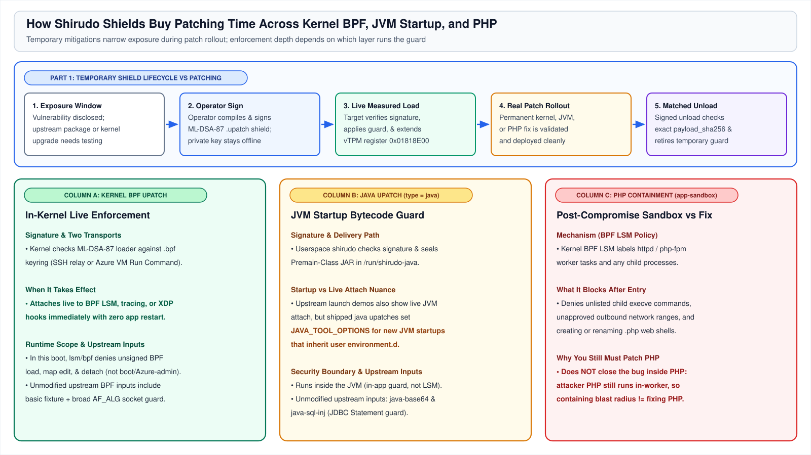

# Bringing Up Shirudo on an Azure Trusted Launch VM: Kernel, vTPM, and Runtime Field Notes

**By Johnson Shi**

*Status: Evidence-led platform bring-up draft. Independent experimental port on standalone Ubuntu 26.04 IaaS VMs, not official Azure or Microsoft support, and not a production or managed AKS deployment.*

When OpenAI and Cisco introduced [Shirudo](https://openai.com/index/introducing-shirudo/) alongside [Cisco Isovalent's technical write-up](https://isovalent.com/blog/post/cisco-openai-shirudo/) and open-sourced the codebase at [`shirudo-dev/shirudo`](https://github.com/shirudo-dev/shirudo), I wanted to get my hands dirty and bring it up on an Azure VM myself. Reading architecture diagrams tells you how a security runtime is supposed to fit together. Booting a custom kernel, sealing kernel keyrings in an initrd, and watching a virtual TPM evaluate policy sessions shows you where cloud virtual hardware actually agrees or disagrees with the assumptions in the code.

Take note: this repository is an independent experimental port to learn how Shirudo behaves on Azure Generation 2 Trusted Launch virtual machines. Shirudo itself is pre-release software upstream, and nothing here represents official Azure support or a production hardening guide.

I ran this bring-up on two standalone Azure IaaS VMs provisioned from the public Canonical Ubuntu 26.04 LTS Marketplace image (`Canonical:ubuntu-26_04-lts:server`, exact Marketplace base image version `26.04.202611100`; note that `26.04.202611100` is the base OS image version, not the running kernel on the enforced target):

- **Signing operator (`Standard_D32ds_v5`):** Trusted Launch with **vTPM on** and **Secure Boot on**. Compiles the custom kernel and Shirudo packages, holds the private signing keys, and verifies target evidence offline.
- **Protected target (`Standard_D4ds_v5`):** Trusted Launch with **vTPM on** and **Secure Boot off**. Boots the custom `bpf-next` kernel and unsigned UKI, seals its keyrings in the initrd, and enforces signed shields.

Managed Azure Kubernetes Service (AKS) is not the deployment I tested here, and the reason is kernel and OS image lifecycle rather than TPM availability. Supported AKS Linux node pools can enable [Trusted Launch with vTPM](https://learn.microsoft.com/azure/aks/use-trusted-launch), whereas [AKS agent-node support policy](https://learn.microsoft.com/azure/aks/support-policies#aks-support-coverage-for-agent-nodes) expressly disallows replacing the agent-node base OS image through IaaS APIs and notes that direct node modifications do not survive lifecycle operations such as upgrades or reimaging. Because Shirudo currently requires a custom-patched `bpf-next` kernel and custom initrd/UKI boot path, standalone IaaS VMs are the right lab surface today, and I make no production or categorical assertions about AKS.

At this stage of the experiment, I have verified the kernel, initrd, BPF LSM enforcement, signed `.upatch` load and payload-matched unload lifecycle, and fresh-nonce offline vTPM verification on an Azure Trusted Launch VM. I have not yet recorded measured outcomes on this target for the four upstream application and kernel shield workloads, runtime performance overhead, or Inspektor Gadget workflows, so this write-up makes zero claims on those fronts until measured receipts are in hand.

*Figure 1: Experimental two-VM architecture and trust boundaries on Azure. Editable Mermaid source: [`docs/figures/shirudo-azure-trust-boundary.mmd`](../figures/shirudo-azure-trust-boundary.mmd).*

## What Comes Unmodified from Upstream Shirudo vs What Changed for Azure

Before diving into the kernel and vTPM details, it helps to separate what comes straight out of upstream [`shirudo-dev/shirudo`](https://github.com/shirudo-dev/shirudo) at pinned commit [`ff5dd643ac0b3d68310450a2cb9b668416eac036`](https://github.com/shirudo-dev/shirudo/tree/ff5dd643ac0b3d68310450a2cb9b668416eac036) from the small compatibility layer in this repository.

Upstream Shirudo provides the entire security runtime, signed loader toolchain, attestation protocol, and shield catalog unmodified:

- **One agentless binary across two roles:** Following the [Shirudo quickstart](https://docs.shirudo.dev/start/quickstart.html), a separate **operator** host holds the private **ML-DSA-87** (FIPS 204 post-quantum) signing keys, compiles BPF programs into signed in-kernel loader `.upatch` files, builds `dm-verity` runtime and signed configuration images, and verifies attestation evidence offline. The **target** VM runs no persistent daemon and opens no inbound application ports. Every target action is a one-shot CLI or systemd unit invocation.
- **Boot-time BPF LSM lockdown and sealed keyrings:** During initrd execution, `shirudo init` enrolls the operator's public verification certificates, seals the kernel `.bpf` and `.dm-verity` keyrings, and pins its `lsm/bpf` guard. Within that running kernel boot, local processes (including root) get `EACCES` on denied runtime operations such as loading unsigned BPF programs, mutating protected maps, unpinning links, or modifying sealed `/var/lib/shirudo` state without an operator-signed artifact. (As detailed below, this in-boot kernel guard is not a boot-authenticity boundary when Secure Boot is off, and it is not a boundary against Azure control-plane or offline disk administrators.)
- **Unmodified upstream shield inputs:** Commit [`ff5dd643ac0b3d68310450a2cb9b668416eac036`](https://github.com/shirudo-dev/shirudo/tree/ff5dd643ac0b3d68310450a2cb9b668416eac036/upatches) already ships the exact shield inputs planned for later workload evaluation, including [`upatches/java-base64`](https://github.com/shirudo-dev/shirudo/tree/ff5dd643ac0b3d68310450a2cb9b668416eac036/upatches/java-base64) (a JDK Class-File API guard for `Base64$Decoder.decode0`), [`upatches/java-sql-inj`](https://github.com/shirudo-dev/shirudo/tree/ff5dd643ac0b3d68310450a2cb9b668416eac036/upatches/java-sql-inj) (a Byte Buddy guard for JDBC `Statement` execution), [`upatches/app-sandbox`](https://github.com/shirudo-dev/shirudo/tree/ff5dd643ac0b3d68310450a2cb9b668416eac036/upatches/app-sandbox) (a BPF LSM sandbox for Apache `httpd` and `php-fpm`), and the broad `AF_ALG` socket-blocking BPF LSM shield in [`upatches/kernel-cve`](https://github.com/shirudo-dev/shirudo/tree/ff5dd643ac0b3d68310450a2cb9b668416eac036/upatches/kernel-cve), alongside the `testing/fixtures/basic.bpf.c` lifecycle fixture.

Stock Shirudo did not boot or initialize as shipped on an Azure Trusted Launch VM for three platform-specific reasons. My local changes in this repository stay strictly in that platform integration layer:

1. **Hyper-V guest drivers in the `bpf-next` kernel ([`kernel/azure.conf`](../../kernel/azure.conf)):** Upstream's CI x86-64 kernel profile targets QEMU (`virtio`) and AWS (`ENA`). Built as-is, that kernel cannot see an Azure Generation 2 VM's synthetic SCSI root disk or NIC. I appended a small config fragment on top of Shirudo's carried `bpf-next` kernel patches on an Ubuntu 26.04 VM to compile Hyper-V `VMBus` (`CONFIG_HYPERV`, `CONFIG_HYPERV_VMBUS`, `CONFIG_CONNECTOR`, `CONFIG_HYPERV_UTILS`, `CONFIG_HYPERV_BALLOON`), `storvsc` SCSI storage (`CONFIG_SCSI`, `CONFIG_BLK_DEV_SD`, `CONFIG_BLK_DEV_SR`, `CONFIG_SCSI_FC_ATTRS`, `CONFIG_HYPERV_STORAGE`, `CONFIG_UDF_FS`), synthetic networking `netvsc` (`CONFIG_HYPERV_NET`, with accelerated networking left off on the VM), and `CONFIG_EFIVAR_FS` directly into `vmlinuz`.
2. **Sizing the TPM NV writer primary key to RSA-2048 ([`patches/shirudo/0001-tpm-size-the-NV-writer-key-for-vTPMs-without-RSA-307.patch`](../../patches/shirudo/0001-tpm-size-the-NV-writer-key-for-vTPMs-without-RSA-307.patch)):** Upstream `shirudo init` asks the TPM to create an **RSA-3072** owner-hierarchy primary key as its per-boot NV writer. On the Microsoft Hyper-V vTPM I tested, `TPM2_CreatePrimary` implements RSA-2048 and ECC P-256/P-384, and refuses RSA-3072 with `TPM_RC_VALUE`. Sizing `TPM_NV_RSA_BITS` to `2048` in matching `shirudo-operator` and `shirudo-target` compatibility packages resolved that failure.
3. **Ubuntu 26.04 generic-initrd timing and early TPM setup ([`patches/shirudo/0002-init-retry-boot-image-teardown-while-udev-probes-the.patch`](../../patches/shirudo/0002-init-retry-boot-image-teardown-while-udev-probes-the.patch) and [`infra/target/dracut/91shirudo-tpm2-setup/module-setup.sh`](../../infra/target/dracut/91shirudo-tpm2-setup/module-setup.sh)):** In a `--no-hostonly` `dracut` initrd on Ubuntu 26.04, `udev` device-mapper rules briefly probe new `dm-verity` devices while `shirudo init` tears down its temporary boot mounts, causing `EBUSY` on roughly half of boots unless retried for up to a second (matching how Shirudo's own runtime update path already retries). In addition, `dracut` 110 on Ubuntu 26.04 omits `systemd-tpm2-setup-early.service` from the initrd by default; adding a tiny `dracut` module ensures systemd defines its NvPCRs in the initrd before `shirudo init` attaches its TPM guards and blocks NvPCR definitions from other tasks.

## Keeping the Three Cryptographic Key Roles Straight

When I hit `TPM_RC_VALUE` on the tested Azure vTPM, it was important to check which cryptographic key role failed and what it authorizes. Shirudo separates signing, attestation, and per-boot TPM state extension across three distinct key roles (with separate `bpf` and `config` keypairs on the operator side):

| Key Role in Shirudo | Upstream Algorithm | Tested Azure Compatibility Build | Security Role |
| :--- | :--- | :--- | :--- |
| **Operator signing keypairs** (separate `bpf` and `config` keys) | **ML-DSA-87** (FIPS 204 post-quantum) | **ML-DSA-87** (unchanged) | Held only on the operator VM. The `bpf` keypair signs `.upatch` load/unload artifacts; the `config` keypair signs `dm-verity` runtime and config images. |
| **TPM attestation key (AK)** | **ECDSA NIST P-256** (under endorsement hierarchy) | **ECDSA NIST P-256** (unchanged) | Lives in the target vTPM. Signs `TPM2_Quote` over PCRs and `TPM2_NV_Certify` over the measurement register with a verifier's fresh nonce. |
| **TPM NV writer key** | **RSA-3072** (under owner hierarchy, random per-boot seed) | **RSA-2048** (`TPM_NV_RSA_BITS=2048`) | Ephemeral per-boot primary key inside the target vTPM that authorizes policy-gated `TPM2_NV_Extend` updates to Shirudo's measurement register (`0x01818E00`). |

Lowering `TPM_NV_RSA_BITS` from `3072` to `2048` did **not** touch the post-quantum **ML-DSA-87** operator keypairs that gate kernel BPF loads and config images, and it did **not** touch the **ECDSA P-256** attestation key that signs quotes. It changed only the local per-boot TPM owner primary key that signs policy sessions for `TPM2_NV_Extend`. Both the operator binary and the target binary must be built with the same `TPM_NV_RSA_BITS` value because the TPM NV index's `Name` hashes the writer key's public area (24-byte header plus RSA modulus), and `shirudo attest verify` recomputes that exact `Name` offline.

## Measured Platform State and Two Honest Trust Caveats

With the Hyper-V `bpf-next` kernel installed on an Ubuntu 26.04 Trusted Launch target VM (Generation 2, vTPM enabled, Secure Boot disabled) and chainloaded into a Unified Kernel Image (UKI) from GRUB, I observed the full platform baseline come up cleanly:

- `shirudo init` executed inside the initrd, bound the per-boot TPM NV measurement register (`0x01818E00`) under PCRs 9 and 11, and anchored it in PCR 9.
- Both kernel keyrings (`.bpf` and `.dm-verity`) sealed before switching to the root filesystem.
- `shirudo status` reported an overall verdict of `ok` with all **seven Shirudo status conditions** at `OK`: `LsmAttached`, `KeyringSealed`, `ChainIntact`, `UpatchesMeasured`, `TpmMeasured`, `ConfigActive`, and `XdpCovered`. I also rechecked the earlier live target VM before writing these notes and confirmed all seven conditions remained `OK`.
- Using upstream's `basic` fixture, I verified a signed `.upatch` load on the target, a **payload-matched signed unload** (where the signed unload directive commits to the loaded artifact's `payload_sha256` and extends the measurement chain forward), and offline `shirudo attest verify` on the operator VM with a **fresh nonce**.
- No external inbound application port needed to be opened on the target VM.

Three trust-boundary and deployment caveats matter when interpreting those results on this setup:

1. **Boot authentication caveat (vTPM on, Secure Boot off, unsigned UKI):** Because Microsoft's default UEFI Secure Boot CA does not sign my custom `bpf-next` kernel or generated UKI, I booted the target VM with **Secure Boot turned off** and an **unsigned UKI**. `systemd-stub` and UEFI firmware still extend PCR measurements into the vTPM, so `shirudo attest verify` can check PCR digests, **but PCR measurements alone do not authenticate the boot**. Without UEFI Secure Boot enforcing signed boot binaries (for example by enrolling a custom UEFI/MOK signing key and signing the UKI), early boot code on disk is recorded rather than prevented from running.
2. **State consistency vs hardware identity caveat (self-reported AK):** Running `shirudo attest` with a fresh nonce and checking the output offline with `shirudo attest verify` proves **freshness and internal consistency of the reported state** for whoever holds that ECDSA P-256 attestation key (AK), and pinning `--ak-name` confirms future quotes come from the same key. On its own, however, a **self-reported AK proves state, not VM hardware identity**. Proving that the AK genuinely lives inside a specific Azure Trusted Launch vTPM requires validating the vTPM Endorsement Key (EK) against a trusted EK certificate chain and completing a `TPM2_MakeCredential` / `TPM2_ActivateCredential` round-trip (`shirudo attest challenge`).
3. **Non-deployable CI kernel profile (`capability,bpf`) and host BPF interoperability:** Upstream's [`testing/kernel/kernel-ci.conf`](https://github.com/shirudo-dev/shirudo/blob/ff5dd643ac0b3d68310450a2cb9b668416eac036/testing/kernel/kernel-ci.conf) at the pinned commit explicitly marks its profile as a *"small, non-deployable kernel for shirudo CI"* and sets `CONFIG_LSM="bpf"`. On the booted Azure target, active LSMs were `capability,bpf`; [`kernel/azure.conf`](../../kernel/azure.conf) adds Hyper-V guest drivers, **not** the Ubuntu distribution's full security profile (such as AppArmor, Yama, or Lockdown). Furthermore, as upstream's [interoperability guide](https://docs.shirudo.dev/operate/plan/interoperability.html) documents, once `lsm/bpf` attaches in the initrd, **other unsigned BPF loads on the host are denied**, including third-party eBPF observability or networking agents and `systemd`'s BPF-backed unit hardening and firewall settings. That qualifies both where this lab kernel belongs and any blanket "drop-in" or performance comparisons against a stock Ubuntu cloud kernel.

## Temporary Mitigations vs Patching, Live BPF vs Java, and PHP Containment

Studying upstream's code and shipped `upatches/` catalog also clarifies what Shirudo shields actually do across different language runtimes, and why they complement rather than replace regular patching.

*Figure 2: Temporary shield lifecycle and enforcement boundaries across Kernel BPF, Java agent upatches, and PHP containment. Editable Mermaid source: [`docs/figures/shirudo-shield-mechanisms.mmd`](../figures/shirudo-shield-mechanisms.mmd).*

### Temporary Shields Buy Rollout Time, Not Permanent Fixes

Every production security team knows the gap between when a critical advisory drops and when a tested kernel reboot or JVM/runtime upgrade can safely roll across a fleet. Shirudo shields are built for that gap. An operator signs a focused `.upatch` guard, deploys it onto live hosts while the real package or kernel fix goes through qualification, and then retires the guard with a signed, payload-matched unload directive once the permanent patch is live. Because an unload directive checks `payload_sha256` and extends the TPM measurement chain, operators get cryptographic evidence both that the temporary mitigation went in and that it came back out cleanly.

### Live Kernel BPF Upatches vs Java Agent Upatches (Startup vs Attach)

Meanwhile as a refresher, not every `.upatch` sits at the same boundary:

- **Kernel BPF upatches** (such as upstream's `basic` fixture or the `AF_ALG` socket guard in `upatches/kernel-cve`) compile into signed in-kernel BPF loader programs verified by the Linux kernel against the sealed `.bpf` keyring (staged in this Azure lab via workstation SSH relay or invoked via Azure VM Run Command, alongside upstream Shirudo's `bpm` OCI pull workflow). When loaded, they attach immediately to live kernel BPF LSM, tracing, or XDP hooks with zero process restart. Within the authorized running kernel image during this boot, the pinned `lsm/bpf` guard denies local processes (including root) from loading unsigned BPF programs, mutating protected maps, or detaching/unpinning links without an artifact signed by the operator's ML-DSA-87 `bpf` keypair; it is not a boot-authenticity boundary (when Secure Boot is off) or a boundary against Azure VM/disk administrators.
- **Java upatches (`type = "java"`)** work inside userspace and the JVM. In OpenAI and Cisco's launch showcase, a generated Java bytecode check was attached to a running Elasticsearch JVM to reject malformed Base64 tails without a service restart. In Shirudo's shipped `java` upatch mechanism (used by [`upatches/java-base64`](https://github.com/shirudo-dev/shirudo/tree/ff5dd643ac0b3d68310450a2cb9b668416eac036/upatches/java-base64) and [`upatches/java-sql-inj`](https://github.com/shirudo-dev/shirudo/tree/ff5dd643ac0b3d68310450a2cb9b668416eac036/upatches/java-sql-inj)), `shirudo` verifies the signature in userspace, seals a `java.lang.instrument` JAR (`Premain-Class`) under `/run/shirudo-java/`, and publishes `-javaagent:` in `JAVA_TOOL_OPTIONS` via `environment.d` for **JVMs that start afterward** and inherit that environment. System services or containers that do not read user `environment.d` need explicit `-javaagent` wiring, or a separate dynamic attach path for already-running JVMs. Just as importantly, a Java agent executes inside the application's JVM process: it is a targeted application-layer mitigation, not a kernel boundary against root.

### PHP Containment (`app-sandbox`) vs Fixing PHP

Separately, upstream's [`upatches/app-sandbox`](https://github.com/shirudo-dev/shirudo/tree/ff5dd643ac0b3d68310450a2cb9b668416eac036/upatches/app-sandbox) package is a helpful example of **post-compromise containment** as opposed to fixing an interpreter bug. Unlike Java bytecode instrumentation, `app-sandbox` does not reach inside the PHP interpreter to parse or patch PHP code. If a PHP version or web application has a code-execution flaw, a malicious request can still run attacker PHP code inside the web worker.

What `app-sandbox` enforces instead is a kernel BPF LSM sandbox around labeled `httpd` and `php-fpm` worker binaries and any child tasks they spawn:

- It blocks those tasks from executing arbitrary programs (`execve`) outside their allowed binary set.
- It restricts outbound socket connections to approved loopback or private network ranges.
- It refuses creating, renaming, or opening `.php` files for writing inside web roots (stopping standard webshell drop-and-persist steps).

Containing the blast radius in the kernel buys valuable time against common post-exploitation steps, while upgrading PHP remains mandatory to close the hole inside the application itself.

## What Remains Unmeasured and What Receipts Would Change This Write-Up

This field note intentionally stops at verified platform bring-up and upstream architectural mechanics. Several concrete sets of measurements are still ahead and would directly expand or revise these conclusions once recorded:

1. **Measured outcomes across the four upstream shield workloads:** Running the unmodified upstream shields (`java-base64`, `java-sql-inj` JDBC guard, `app-sandbox` for Apache/PHP-FPM, and the broad `AF_ALG` kernel shield) end-to-end on the Azure target VM, verifying both blocked bad inputs and unaffected benign requests, and documenting exact JVM startup vs service unit behavior.
2. **Endorsement Key (EK) credential activation on Azure Trusted Launch:** Running `shirudo attest challenge` / `TPM2_ActivateCredential` against the Azure vTPM EK certificate chain. If verified end-to-end, that would strengthen the attestation section from fresh state consistency under a self-reported AK to hardware-rooted vTPM key residency.
3. **Custom UEFI Secure Boot key enrollment and signed UKI boot:** Signing the custom `bpf-next` kernel and UKI and enabling Trusted Launch Secure Boot. That would remove the unauthenticated early-boot caveat where PCRs record boot phases without firmware signature enforcement.
4. **Latency and CPU overhead measurements:** Measuring syscall, network, and request latency deltas under baseline vs sealed BPF LSM enforcement and active shields.
5. **Inspektor Gadget (IG) coexistence or integration:** Evaluating how signed BPF enforcement interacts with observability tooling once dedicated testing begins.

## References

- OpenAI announcement: [OpenAI and Cisco introduce Shirudo](https://openai.com/index/introducing-shirudo/)
- Cisco Isovalent technical post: [Cisco and OpenAI introduce Shirudo](https://isovalent.com/blog/post/cisco-openai-shirudo/)
- Shirudo documentation: [Quickstart](https://docs.shirudo.dev/start/quickstart.html) and [Interoperability](https://docs.shirudo.dev/operate/plan/interoperability.html)
- Upstream repository: [`shirudo-dev/shirudo`](https://github.com/shirudo-dev/shirudo) (tested pin [`ff5dd643ac0b3d68310450a2cb9b668416eac036`](https://github.com/shirudo-dev/shirudo/tree/ff5dd643ac0b3d68310450a2cb9b668416eac036), including [`testing/kernel/kernel-ci.conf`](https://github.com/shirudo-dev/shirudo/blob/ff5dd643ac0b3d68310450a2cb9b668416eac036/testing/kernel/kernel-ci.conf))
- Azure AKS Trusted Launch docs: [Deploy AKS node pools with Trusted Launch](https://learn.microsoft.com/azure/aks/use-trusted-launch)
- Azure AKS agent-node support policy: [AKS support coverage for agent nodes](https://learn.microsoft.com/azure/aks/support-policies#aks-support-coverage-for-agent-nodes)
