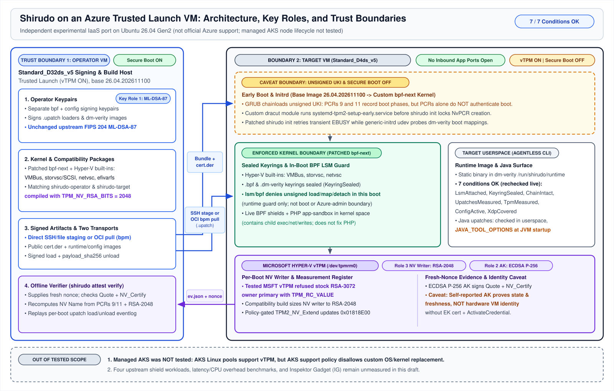

# Bringing Up Shirudo on an Azure Linux VM: What Got Blocked, What Kept Working, and What Changed Under the Hood

**By Johnson Shi**

*Status: Independent lab notes with two committed, operator-verified measurement receipts from Microsoft Azure: real Ubuntu PHP-FPM and H2 database runtimes ([`docs/results/azure-controls-real-runtimes.json`](../results/azure-controls-real-runtimes.json)) and minimal local fixtures ([`docs/results/azure-controls.json`](../results/azure-controls.json)), plus post-run kernel setting restoration ([`docs/results/azure-af-alg-restoration.json`](../results/azure-af-alg-restoration.json)). Experimental port on standalone Ubuntu 26.04 VMs, not official Azure or Microsoft support.*

Every production security team knows the hardest stretch of a serious vulnerability is the patching gap: the days or weeks between learning a bug exists and finishing the rebuild, staging verification, and rolling upgrade across production servers. During that window, you cannot simply shut off the service, yet leaving the vulnerable behavior exposed invites exploitation.

When Greg Brockman announced [Shirudo](https://openai.com/index/introducing-shirudo/) (Japanese for "shield"), the open-source Linux runtime built by [OpenAI and Cisco](https://openai.com/index/introducing-shirudo/), the core idea immediately stood out for cloud infrastructure teams. Instead of waiting for a full package upgrade or reboot, an operator loads a small, cryptographically signed temporary rule onto a running Linux host. The goal is to take away the specific action an exploit relies on while letting the service keep doing its ordinary work, then remove the rule cleanly once the permanent fix is rolled out.

Reading [OpenAI's announcement](https://openai.com/index/introducing-shirudo/), [Cisco Isovalent's technical post](https://isovalent.com/blog/post/cisco-openai-shirudo/), and Daniel Borkmann and John Fastabend's [Linux Plumbers Conference talk](https://lpc.events/event/20/contributions/2437/), I wanted to test Shirudo myself on Microsoft Azure virtual machines. Could I boot it on Azure Trusted Launch VMs, load real upstream rules, and verify that they actually cut off a risky action without breaking normal application work?

Before getting into kernels or virtual TPMs, here is the clearest result from the Azure target VM.

## First result: blocking `canary.php` while `canary.txt` keeps working

On an Azure Linux virtual machine, I ran an unprivileged Ubuntu `php-fpm` web worker (`8.5.4-0ubuntu1.6`) over a private local Unix socket and asked it to write the same harmless text to two new files in a private temporary directory outside any web root: `canary.php` and `canary.txt`.

Observed result (`app-sandbox`, real Ubuntu PHP-FPM run):

```text
Before:   canary.php -> written   | canary.txt -> written
Active:   canary.php -> EACCES    | canary.txt -> written
Restored: canary.php -> written   | canary.txt -> written
```

- **Before loading the shield:** The PHP worker created both `canary.php` and `canary.txt`.
- **With the shield active:** Linux refused `canary.php` with `EACCES` (permission denied), while letting the same worker write `canary.txt`.
- **After the signed unload:** Once I ran the matching signed unload command, the worker created both `canary.php` and `canary.txt` again.

**Why this boundary matters:** A web application often needs to write non-executable data such as `.txt` logs, uploads, or exports, but it rarely needs to create new executable `.php` scripts at runtime. Attackers who trigger a web bug frequently try to drop a new `.php` script so they can execute their own code on future requests. Both `canary.php` and `canary.txt` in my test contained inert text outside any web root, not an attempted compromise. Just as importantly, `app-sandbox` does not reach inside PHP or fix a bug in PHP application code. It acts as temporary kernel containment around the `php-fpm` worker (and any child processes it spawns) while you qualify and roll out the real software upgrade.

**Attribution and scope:**
- **OpenAI and Cisco (upstream [`shirudo-dev/shirudo`](https://github.com/shirudo-dev/shirudo)):** Built Shirudo and the five upstream controls tested here (four protective shields plus one signed no-op lifecycle control), used unchanged from pinned commit [`ff5dd643ac0b3d68310450a2cb9b668416eac036`](https://github.com/shirudo-dev/shirudo/tree/ff5dd643ac0b3d68310450a2cb9b668416eac036).
- **My Azure lab work (this repository):** Adapted Shirudo's runtime and kernel configuration to boot, seal, and attest on Azure Trusted Launch VMs (one Hyper-V kernel driver fragment, one early-boot TPM setup hook, and two small runtime compatibility patches), recorded the measurement receipts, and added offline replay scripts.

### Replay this result offline (\$0, no Azure account required)

You can replay the recorded evidence for this test on your own laptop right now without an Azure subscription or a cloud VM. Run this command from the repository root:

```sh
demos/controls/app-sandbox.sh --receipt docs/results/azure-controls-real-runtimes.json
```

Exact output from the committed Azure receipt:

```text
Recorded evidence (offline replay): app-sandbox, one row from the full suite; no guest contacted.
Upstream: https://github.com/shirudo-dev/shirudo/tree/ff5dd643ac0b3d68310450a2cb9b668416eac036/upatches/app-sandbox
Before: Ubuntu PHP-FPM worker (private Unix socket): both canaries written
Active: .php denied (EACCES); .txt written
Restored: both canaries written after unload
Positive control: inert .txt write succeeded in all three phases
```

All five offline replay scripts in [`demos/controls/`](../../demos/controls/README.md) are completely free (\$0) and local. Only the live lab provisioning ([`docs/azure-lab-runbook.md`](../azure-lab-runbook.md)) and the live Azure VM Run Command runner (`demos/controls/run.sh`) contact Azure or spend cloud credits.

## What happened across the other four controls on Azure

In OpenAI and Cisco's launch showcase, they demonstrated attaching a generated Base64 decoder check to a running Elasticsearch service to block a live "Java4Shell" exploit attempt without a restart. **I did not reproduce that live exploit demo, and I did not run vulnerable web applications or live exploit payloads on Azure.** Instead, I ran bounded, defensive checks across five upstream Shirudo controls (four protective shields and one signed no-op lifecycle check) to verify what each rule blocked, what normal work continued working, and whether the machine's state and hardware measurement log returned cleanly to baseline afterward.

I recorded two separate five-control runs on the same Azure target VM and kept their receipts separate:
- **Run 2 (`docs/results/azure-controls-real-runtimes.json`):** Tested against real Ubuntu application packages (`php8.5-fpm` and the H2 Java database engine `libh2-java`).
- **Run 1 (`docs/results/azure-controls.json`):** An earlier run using minimal local stand-ins (a temporary copy of Python named `php-fpm` and a mock SQLite database driver) before repeating the suite with the real Ubuntu runtimes.

Here is what happened in the other four controls alongside `app-sandbox`:

### 1. Blocking a suspicious SQL pattern in Java while normal reads still return `7` (`java-sql-inj`)

Observed result (Run 2, Ubuntu H2 `2.2.220-1build1` on a fresh empty in-memory DB):

```text
Before:   SELECT 7 -> 7  | harmless false comparison -> empty (0 rows)
Active:   SELECT 7 -> 7  | harmless false comparison -> SecurityException (new JVM)
Restored: SELECT 7 -> 7  | harmless false comparison -> empty (0 rows)
```

Replay this control offline:

```sh
demos/controls/java-sql-inj.sh --receipt docs/results/azure-controls-real-runtimes.json
```

Java applications talk to SQL databases through **JDBC** (Java Database Connectivity, the standard Java interface for sending SQL statements). Upstream Shirudo includes a Java startup guard (`upatches/java-sql-inj`) that hooks JDBC `Statement` execution and checks the SQL text against lexical rules before the database runs it. If a query matches a suspicious pattern (such as classic SQL injection tautologies or arithmetic comparisons often used to probe a database), the guard rejects the query with a `SecurityException`.

To test this against a real database driver without opening any network port or running a real attack, I used **H2** (a self-contained SQL database engine written in Java, from Ubuntu's `libh2-java` `2.2.220-1build1` package) backed by a fresh, empty in-memory database. In the earlier fixture run, I used a mock JDBC `Statement` backed by an empty in-memory SQLite database.

Importantly, **this test was not a multi-statement break-in attempt or a live SQL injection attack.** In each phase, I ran two fixed, hardcoded, completely harmless read queries:
- **Normal read (`SELECT 7`):** A simple scalar query that asks the database to return the number `7`. It returned `7` in all three phases.
- **Harmless false-comparison read:** A separate, fixed read query whose `WHERE` clause compares two unequal literal numbers. Normally, the database evaluates that comparison as false and returns zero rows (`empty`), but the literal comparison pattern matches the upstream guard's rule and throws `SecurityException` in a newly started JVM while the shield is active.

One-shot signed CLI timings were `756.651 ms` for load and `744.478 ms` for unload in the H2 run (`756.211 ms` load and `733.741 ms` unload in the SQLite fixture run).

### 2. Blocking Linux kernel `AF_ALG` crypto sockets while normal `AF_UNIX` sockets keep working (`cve-2026-31431-af-alg-block`)

Observed result (Run 2, unprivileged unbound socket creation, median of `15` attempts after `3` warmups):

```text
Before:   AF_ALG -> allowed (1,952 ns) | AF_UNIX -> allowed (2,096 ns)
Active:   AF_ALG -> EPERM   (1,442 ns) | AF_UNIX -> allowed (2,124 ns)
Restored: AF_ALG -> allowed (1,929 ns) | AF_UNIX -> allowed (2,111 ns)
```

Replay this control offline:

```sh
demos/controls/af-alg.sh --receipt docs/results/azure-controls-real-runtimes.json
```

The Linux kernel supports multiple socket families. Local services constantly create `AF_UNIX` sockets to communicate with other processes on the same host. The kernel also exposes an `AF_ALG` socket family that lets user-space programs ask the kernel to perform cryptographic operations. Because almost all ordinary applications use user-space crypto libraries (like OpenSSL) rather than `AF_ALG` kernel sockets, blocking unprivileged processes from creating `AF_ALG` sockets is an effective way to cut off a vulnerable kernel crypto code path (such as `CVE-2026-31431`) while waiting for a scheduled kernel reboot window.

In each phase, an unprivileged process ran `15` measured attempts (after `3` warmups) to create and immediately close an unbound `AF_ALG` socket and an unbound `AF_UNIX` socket (no encryption algorithm was bound and no data was sent). In Run 1 (the fixture receipt), the same transitions measured `1,890 ns` (`allowed`) -> `1,446 ns` (`EPERM`) -> `1,886 ns` (`allowed`) for `AF_ALG`, and `2,058` / `2,122` / `1,985 ns` (`allowed`) for `AF_UNIX`. One-shot signed CLI timings were `746.745 ms` load and `730.422 ms` unload in Run 2 (`739.570 ms` load and `727.428 ms` unload in Run 1).

**Important context on the kernel setting (`crypto.af_alg_restrict`):** Both measured runs observed the target VM while its runtime kernel setting `crypto.af_alg_restrict` was already `0`. Having that setting at `0` is why unprivileged `AF_ALG` sockets were allowed at baseline so the allowed-to-denied-to-allowed transition could be measured; neither test script lowered or altered the setting. After both attested runs completed, I checked the compiled kernel package (`7.4-202611240310.g2bf3351c5f89`) against its pinned source tree (`crypto/af_alg.c:32` at commit `2bf3351c5f894697e8443eeef5333d4c4ce90cab`), confirmed that the kernel's compiled default is the stricter value `1` (with no config file or boot-parameter override), and restored `crypto.af_alg_restrict` from `0` back to `1` in a separate post-measurement housekeeping step ([`docs/results/azure-af-alg-restoration.json`](../results/azure-af-alg-restoration.json)). I did not re-run the socket probe after restoring the setting to `1`.

### 3. Attaching the Java Base64 guard to an already-running JVM without a restart (`java-base64`, continuity only)

Observed result (Run 2, pre-existing sealed JAR `initial_count = 1`, `preserved_preexisting`):

```text
Before attach: decode("Y29udHJvbA==") -> "control" (same PID, same JVM start time)
After attach:  decode("Y29udHJvbA==") -> "control" (upstream install diagnostic emitted)
Restored:      pre-existing sealed JAR preserved (not unloaded)
```

Replay this control offline:

```sh
demos/controls/java-base64.sh --receipt docs/results/azure-controls-real-runtimes.json
```

On the target VM, the signed `java-base64` guard JAR (`upatches/java-base64`) was already installed before the test suite began (`initial_count = 1`). Because the runner never unloads a pre-existing shield, it kept that signed JAR in place rather than cycling a load and unload.

What I verified here is **running-process continuity across live agent attachment**, not an exploit block. An unprivileged Java process started and decoded the valid Base64 string `Y29udHJvbA==` into `"control"`. I then explicitly attached the sealed upstream `java-base64` agent to that **same running JVM**, which emitted the upstream install confirmation. After attachment, the **exact same JVM process** (verified by an unchanged PID and JVM start timestamp) decoded `Y29udHJvbA==` into `"control"` again without a process restart. Because the pre-existing shield remained installed to preserve the host's initial state, post-unload decoding was not measured.

### 4. Signed kernel no-op lifecycle (`basic`) and three separate layers of verification

Observed result (Run 2, signed BPF no-op load and digest-bound unload):

```text
Before:   absent
Active:   loaded_and_measured (load: 800.637 ms)
Restored: absent              (digest-bound unload: 731.906 ms)
```

Replay this control offline:

```sh
demos/controls/basic.sh --receipt docs/results/azure-controls-real-runtimes.json
```

Upstream's minimal `basic` control (`testing/fixtures/basic.bpf.c`) verified the core signed load and unload lifecycle (`800.637 ms` load and `731.906 ms` unload in Run 2; `752.294 ms` load and `732.024 ms` unload in Run 1). Each unload file commits to the exact SHA-256 digest of the loaded payload.

To keep the evidence boundaries clear, three separate checks establish different facts after each five-control run:
- **Hardware measurement proof (vTPM):** Before and after each run, the separate operator VM sent a fresh random 32-byte nonce to the target VM's vTPM. Offline verification (`shirudo attest verify`) checked the loaded-rule history in `0x01818E00` and `PCR 13` against the expected signed changes, and confirmed that a deliberately wrong nonce was rejected.
- **Application behavior probes:** The PHP, H2/SQLite, socket, and JVM probes established the actual denied and allowed writes, queries, sockets, and continuity behavior.
- **Guest state cleanup check:** A separate guest check confirmed that the starting shield set was restored with no new TCP listeners.

Each layer proves its own piece: the vTPM attested the signed rule history, not PHP file writes or open network ports.

## How Shirudo Shields Work Across the Linux Kernel, Java, and PHP

Studying upstream's code alongside these five tests makes it clear how Shirudo applies temporary mitigations across different layers of the stack, and why different shield types attach differently.


*Figure 1: Temporary shield lifecycle and enforcement boundaries across Kernel BPF, Java agent upatches, and PHP containment. Editable Mermaid source: [`docs/figures/shirudo-shield-mechanisms.mmd`](../figures/shirudo-shield-mechanisms.mmd).*

### Live Kernel BPF Shields vs. Java Agent Shields (Startup vs. Live Attach)

Not every `.upatch` file sits at the same boundary:

- **Kernel BPF upatches** (such as `basic`, `app-sandbox`, and the `AF_ALG` socket block) use **eBPF**, a Linux kernel technology that runs small, verifier-checked programs at specific kernel security and tracing checkpoints. Upstream Shirudo compiles these into signed in-kernel loader programs that the Linux kernel checks against its sealed `.bpf` keyring. When loaded, kernel hooks attach immediately without rebooting the machine (for task-labeling sandboxes like `app-sandbox`, the sandbox label takes effect the next time a matching worker binary starts via `exec`). During that kernel boot, Shirudo's pinned `lsm/bpf` guard refuses attempts by local processes (even `root`) to load unsigned eBPF programs, alter protected maps, or detach active links without an artifact signed by the operator's private key.
- **Java upatches (`type = "java"`)** run inside user space and the Java Virtual Machine (JVM) because concepts like SQL query strings and Java's `Base64` class live inside the application runtime rather than the OS kernel. In Shirudo's shipped `java` upatch workflow (used by [`upatches/java-base64`](https://github.com/shirudo-dev/shirudo/tree/ff5dd643ac0b3d68310450a2cb9b668416eac036/upatches/java-base64) and [`upatches/java-sql-inj`](https://github.com/shirudo-dev/shirudo/tree/ff5dd643ac0b3d68310450a2cb9b668416eac036/upatches/java-sql-inj)), `shirudo` checks the signature in user space, places a read-only `java.lang.instrument` JAR (`Premain-Class`) under `/run/shirudo-java/`, and exports `-javaagent:` in `JAVA_TOOL_OPTIONS` via `environment.d` so **newly started JVMs** that inherit that environment load the guard automatically at startup (as in the H2 JDBC test). Already-running JVMs, or system services that ignore `environment.d`, require explicit attachment (as exercised in the `java-base64` continuity check) or explicit `-javaagent` flags. Just as importantly, a Java agent runs inside the JVM process: it is an application-layer mitigation, not a kernel boundary against `root`.

## Under the Hood: What Came from Upstream vs. What Changed for Azure

To run these tests on Azure, I provisioned two standalone Azure Generation 2 Trusted Launch virtual machines from the public Canonical Ubuntu 26.04 LTS image (`Canonical:ubuntu-26_04-lts:server`, exact Marketplace base image version `26.04.202611100`, with the enforced target booting the custom kernel `7.4-shirudo-azure-20261124` and OpenJDK `25.0.5.1+2-1~26.04.1`):

- **Signing operator VM (`Standard_D32ds_v5`):** Trusted Launch with **vTPM on** and **Secure Boot on**. Compiles the custom kernel and Shirudo packages, holds the private signing keys, and verifies target hardware quotes offline.
- **Protected target VM (`Standard_D4ds_v5`):** Trusted Launch with **vTPM on** and **Secure Boot off**. Boots the custom `bpf-next` kernel and Unified Kernel Image (UKI), seals its kernel keyrings during early boot (`initrd`), and enforces signed shields.

*(Why standalone VMs instead of managed Azure Kubernetes Service? Supported AKS Linux node pools can enable [Trusted Launch with vTPM](https://learn.microsoft.com/azure/aks/use-trusted-launch), but [AKS agent-node support policy](https://learn.microsoft.com/azure/aks/support-policies#aks-support-coverage-for-agent-nodes) disallows replacing the node's base OS image or kernel through IaaS APIs. Because Shirudo currently requires a custom-patched `bpf-next` kernel and custom initrd/UKI boot path, standalone IaaS VMs are the appropriate lab surface today.)*



*Figure 2: Experimental two-VM architecture and trust boundaries on Azure. Editable Mermaid source: [`docs/figures/shirudo-azure-trust-boundary.mmd`](../figures/shirudo-azure-trust-boundary.mmd).*

Upstream [`shirudo-dev/shirudo`](https://github.com/shirudo-dev/shirudo) at commit [`ff5dd643ac0b3d68310450a2cb9b668416eac036`](https://github.com/shirudo-dev/shirudo/tree/ff5dd643ac0b3d68310450a2cb9b668416eac036) provided the `ML-DSA-87` post-quantum signing toolchain, the `dm-verity` read-only image builders, the vTPM quote verifier, and all five shield sources unchanged.

However, stock Shirudo did not boot or initialize as shipped on an Azure Trusted Launch VM for three platform-specific reasons. My changes in this repository stay strictly in that integration layer:

1. **Adding Microsoft Hyper-V guest drivers to the custom kernel ([`kernel/azure.conf`](../../kernel/azure.conf)):** Upstream's CI x86-64 kernel config targets QEMU (`virtio`) and AWS (`ENA`). Built as-is, that kernel cannot see an Azure Generation 2 VM's synthetic SCSI root disk or network card. I appended a small config fragment on top of Shirudo's carried `bpf-next` kernel patches to compile Hyper-V `VMBus` (`CONFIG_HYPERV`, `CONFIG_HYPERV_VMBUS`, `CONFIG_CONNECTOR`, `CONFIG_HYPERV_UTILS`, `CONFIG_HYPERV_BALLOON`), `storvsc` SCSI storage (`CONFIG_SCSI`, `CONFIG_BLK_DEV_SD`, `CONFIG_BLK_DEV_SR`, `CONFIG_SCSI_FC_ATTRS`, `CONFIG_HYPERV_STORAGE`, `CONFIG_UDF_FS`), synthetic networking `netvsc` (`CONFIG_HYPERV_NET`, with accelerated networking left off on the VM), and `CONFIG_EFIVAR_FS` directly into `vmlinuz`.
2. **Sizing the internal vTPM NV writer key to RSA-2048 ([`patches/shirudo/0001-tpm-size-the-NV-writer-key-for-vTPMs-without-RSA-307.patch`](../../patches/shirudo/0001-tpm-size-the-NV-writer-key-for-vTPMs-without-RSA-307.patch)):** During early boot, `shirudo init` asks the TPM to create a temporary per-boot **RSA-3072** owner-hierarchy primary key that authorizes updates (`TPM2_NV_Extend`) to Shirudo's measurement register. On the Microsoft Hyper-V vTPM I tested, `TPM2_CreatePrimary` supports RSA-2048 and elliptic-curve P-256/P-384, and rejects RSA-3072 with `TPM_RC_VALUE`. Changing `TPM_NV_RSA_BITS` to `2048` in matching operator and target builds fixed that failure.
3. **Ubuntu 26.04 early-boot (`initrd`) unmount retry and TPM setup ([`patches/shirudo/0002-init-retry-boot-image-teardown-while-udev-probes-the.patch`](../../patches/shirudo/0002-init-retry-boot-image-teardown-while-udev-probes-the.patch) and [`infra/target/dracut/91shirudo-tpm2-setup/module-setup.sh`](../../infra/target/dracut/91shirudo-tpm2-setup/module-setup.sh)):** In a generic `dracut` initrd on Ubuntu 26.04, background `udev` device-mapper rules briefly probe newly created `dm-verity` volumes while `shirudo init` tears down its temporary boot mounts, causing `EBUSY` on roughly half of boots unless retried for up to a second (matching how Shirudo's own runtime update path already retries). In addition, `dracut` 110 on Ubuntu 26.04 omits `systemd-tpm2-setup-early.service` from the standard initrd image; adding a small `dracut` module ensures `systemd` sets up its TPM state in the initrd before `shirudo init` locks down further NvPCR definitions.

### Keeping the Three Cryptographic Key Roles Straight

When I ran into `TPM_RC_VALUE` on the Azure vTPM, I wanted to be 100% certain which cryptographic key was affected and what it authorizes. Shirudo separates signing, hardware quote attestation, and per-boot register updates across three different key roles:

| Key Role in Shirudo | Upstream Algorithm | Tested Azure Compatibility Build | Security Role |
| :--- | :--- | :--- | :--- |
| **1. Operator signing keypairs** (separate `bpf` and `config` keys) | **ML-DSA-87** (FIPS 204 post-quantum) | **ML-DSA-87** (unchanged) | Held only on the operator VM. The `bpf` keypair signs `.upatch` load/unload files; the `config` keypair signs `dm-verity` runtime and configuration images. |
| **2. TPM attestation key (AK)** | **ECDSA NIST P-256** (endorsement hierarchy) | **ECDSA NIST P-256** (unchanged) | Lives inside the target VM's vTPM. Signs `TPM2_Quote` over PCRs and `TPM2_NV_Certify` over the measurement register using the operator's fresh random nonce. |
| **3. TPM NV writer key** | **RSA-3072** (owner hierarchy, random per-boot seed) | **RSA-2048** (`TPM_NV_RSA_BITS=2048`) | Temporary per-boot primary key inside the target vTPM that authorizes policy-gated `TPM2_NV_Extend` updates to Shirudo's measurement register (`0x01818E00`). |

Lowering `TPM_NV_RSA_BITS` from `3072` to `2048` did **not** touch the post-quantum **ML-DSA-87** operator keys that guard kernel BPF loads and configuration images, and it did **not** touch the **ECDSA P-256** attestation key that signs hardware quotes. It changed only the temporary per-boot internal TPM key used for local policy sessions. Because the TPM measurement index's `Name` includes a hash of that writer key's public parameters, both the operator binary and the target binary must be compiled with the same `TPM_NV_RSA_BITS` setting.

## Measured Boot vs. Authenticated Boot, and Three Honest Caveats

With the custom kernel and UKI booted on the Azure target VM, `shirudo status` reported an overall verdict of `ok` with all **seven runtime conditions** at `OK`: `LsmAttached`, `KeyringSealed`, `ChainIntact`, `UpatchesMeasured`, `TpmMeasured`, `ConfigActive`, and `XdpCovered`.

When evaluating what that verification proves on this lab setup, three honest boundaries matter:

1. **Measured boot vs. Authenticated boot (vTPM on, Secure Boot off, unsigned UKI):**
   It is easy to confuse *measured boot* with *authenticated boot*. In **authenticated boot**, UEFI Secure Boot checks a firmware-trusted cryptographic signature before executing the bootloader or Unified Kernel Image (UKI), refusing to boot modified files on disk. Because Microsoft's standard Azure UEFI Secure Boot certificates do not sign my custom-compiled kernel or generated UKI, I booted the target VM with **Secure Boot turned off** and an **unsigned UKI** (while keeping Secure Boot on for the operator VM). With **vTPM turned on**, the firmware, `systemd-stub`, and `shirudo init` still perform **measured boot**: they record cryptographic hashes of the boot path, configuration root (`PCR 13`), and loaded shields into the vTPM so the operator can verify them. However, recording measurements in a vTPM does not prevent an altered unsigned boot image on disk from running if someone modifies `/boot` beforehand. Achieving full authenticated boot on Azure would require enrolling a custom UEFI Secure Boot key and signing the UKI.
2. **First-use enrolled attestation key vs. hardware endorsement certificate chain:**
   Before running the test suites, I enrolled and pinned the target vTPM's ECDSA P-256 attestation key (AK) once over an authenticated Azure RBAC administrator channel, never trusting a key self-reported inside the test quotes themselves. Requesting quotes with fresh 32-byte nonces before and after each suite proves **freshness, baseline state continuity, and exact planned signed transitions** for that enrolled VM. However, this lab did **not** validate a hardware Endorsement Key (EK) certificate chain or call Azure Guest Attestation, and verifying transitions from a baseline does not by itself audit arbitrary prior history before the baseline.
3. **CI kernel security profile (`capability,bpf`) and host eBPF coexistence:**
   Upstream's [`testing/kernel/kernel-ci.conf`](https://github.com/shirudo-dev/shirudo/blob/ff5dd643ac0b3d68310450a2cb9b668416eac036/testing/kernel/kernel-ci.conf) describes itself as a *"small, non-deployable kernel for shirudo CI"* and sets `CONFIG_LSM="bpf"`. On the booted Azure target, active Linux Security Modules were `capability,bpf`; [`kernel/azure.conf`](../../kernel/azure.conf) adds Hyper-V drivers rather than Ubuntu's full distribution LSM stack (such as AppArmor or Yama). In addition, as upstream's [interoperability guide](https://docs.shirudo.dev/operate/plan/interoperability.html) explains, once `lsm/bpf` locks down BPF loading in the initrd, **other unsigned eBPF programs on the host are denied**, including third-party eBPF monitoring agents and `systemd`'s eBPF-based unit sandboxing features.

## Side-by-Side Receipt Tables (Kept Separate, Never Pooled)

In addition to verifying that all five upstream packages compiled cleanly on the Azure operator VM with disposable signers (producing five digest-bound load/unload pairs, or ten signed `.upatch` files total), here are the complete measurement tables from the two separate target runs.

### Receipt A: Real Ubuntu PHP-FPM and H2 Runtimes ([`docs/results/azure-controls-real-runtimes.json`](../results/azure-controls-real-runtimes.json))

| Control (Real Ubuntu Runtimes) | Status | Runtime / Test Surface | One-Shot CLI Load / Unload (incl. vTPM, not `p50`) | Observed Before -> With Shield -> After Removal |
| :--- | :--- | :--- | :--- | :--- |
| **`app-sandbox`** (`upatches/app-sandbox`) | **Final (`verified`)** | Unprivileged 1-worker Ubuntu `php-fpm` (`8.5.4-0ubuntu1.6`) over private mode-`0600` Unix socket (`real_php_fpm = true`) | `791.798 ms` / `742.516 ms` | `canary.php`, `canary.txt`: `written, written` -> `EACCES, written` -> `written, written` (temporary containment, does not fix PHP) |
| **`java-sql-inj`** (`upatches/java-sql-inj`) | **Final (`verified`)** | Real Ubuntu H2 (`2.2.220-1build1`) JDBC `Statement` on fresh empty in-memory DB (`sealed_jar = true`) | `756.651 ms` / `744.478 ms` | Fixed scalar read `SELECT 7`: `7` -> `7` -> `7`; fixed harmless false comparison: `empty` -> `policy-exception` (`SecurityException` in new JVM) -> `empty` |
| **`cve-2026-31431-af-alg-block`** (`upatches/kernel-cve`) | **Final (`verified`)** | Unprivileged unbound socket at pre-existing lab `crypto.af_alg_restrict = 0` (`n = 15` after `3` warmups) | `746.745 ms` / `730.422 ms` | `AF_ALG`: `allowed` (`1,952 ns`) -> `EPERM` (`1,442 ns`) -> `allowed` (`1,929 ns`); `AF_UNIX`: `allowed` (`2,096` / `2,124` / `2,111 ns`) |
| **`java-base64`** (`upatches/java-base64`) | **Final (`verified`)** | Pre-existing sealed JAR (`preserved_preexisting`) | Not cycled | Same running JVM (unchanged PID and start time) decoded `"control"` before and after explicit attach (`continuity_only`) |
| **`basic`** (`testing/fixtures/basic.bpf.c`) | **Final (`verified`)** | Signed BPF no-op (`owned_pair`) | `800.637 ms` / `731.906 ms` | `absent` -> `loaded_and_measured` -> `absent` |

### Receipt B: Minimal Fixed Fixtures ([`docs/results/azure-controls.json`](../results/azure-controls.json))

| Control (Minimal Fixed Fixtures) | Status | Runtime / Test Surface | One-Shot CLI Load / Unload (incl. vTPM, not `p50`) | Observed Before -> With Shield -> After Removal |
| :--- | :--- | :--- | :--- | :--- |
| **`app-sandbox`** (`upatches/app-sandbox`) | **Final (`verified`)** | Distro Python copy matching upstream `php-fpm` binary selector (`real_php_fpm = false`) | `781.100 ms` / `745.401 ms` | `canary.php`, `canary.txt`: `written, written` -> `EACCES, written` -> `written, written` |
| **`java-sql-inj`** (`upatches/java-sql-inj`) | **Final (`verified`)** | Mock `java.sql.Statement` backed by empty in-memory SQLite (`sealed_jar = true`) | `756.211 ms` / `733.741 ms` | Fixed scalar read `SELECT 7`: `7` -> `7` -> `7`; fixed harmless false comparison: `empty` -> `policy-exception` (new JVM) -> `empty` |
| **`cve-2026-31431-af-alg-block`** (`upatches/kernel-cve`) | **Final (`verified`)** | Unprivileged unbound socket at pre-existing lab `crypto.af_alg_restrict = 0` (`n = 15` after `3` warmups) | `739.570 ms` / `727.428 ms` | `AF_ALG`: `allowed` (`1,890 ns`) -> `EPERM` (`1,446 ns`) -> `allowed` (`1,886 ns`); `AF_UNIX`: `allowed` (`2,058` / `2,122` / `1,985 ns`) |
| **`java-base64`** (`upatches/java-base64`) | **Final (`verified`)** | Pre-existing sealed JAR (`preserved_preexisting`) | Not cycled | Same running JVM (unchanged PID and start time) decoded `"control"` before and after explicit attach (`continuity_only`) |
| **`basic`** (`testing/fixtures/basic.bpf.c`) | **Final (`verified`)** | Signed BPF no-op (`owned_pair`) | `752.294 ms` / `732.024 ms` | `absent` -> `loaded_and_measured` -> `absent` |

**How to read the timings across both receipts:**
1. **Separate runs are never pooled:** Receipt A and Receipt B were separate invocations on the guest monotonic clock and are reported individually.
2. **Synchronous refusal vs. full socket allocation/close:** During the `AF_ALG` block phase, `1,442 ns` (or `1,446 ns`) is shorter than `1,952 ns` (or `1,890 ns`) because an immediate `EPERM` refusal at the security hook skips allocating and closing a socket. It is **not a speedup, not an application throughput benchmark, and does not measure asynchronous event delivery or Azure control-plane latency** (`observer_delivery_measured = false`, `control_plane_latency_included = false`).
3. **One-shot CLI load/unload includes vTPM work:** Each `operation_ms` figure (`727.428 ms` to `800.637 ms`) is a single one-shot signed CLI command on the target VM that includes synchronous `TPM2_NV_Extend` communication with the Azure vTPM, not a `p50` distribution.
4. **Receipt verification and post-run invariant fields:** Across both receipts, the vTPM attestation block records `fresh_before_and_after = true`, `wrong_nonce_rejected = true`, `ak_enrollment = "separate_Azure_RBAC_TOFU"`, `ek_endorsement_verified = false`, `azure_guest_attestation_service_used = false`, and `historical_intent_approved = false` (proving the loaded-rule measurement history in `0x01818E00` and `PCR 13` within the enrolled trust model), while the separate guest-side post-run check records `shield_set_restored = true` and `no_new_tcp_listeners = true`. For `java-base64`, the receipt records `initial_count = 1`, `lifecycle = "preserved_preexisting"`, `same_pid_and_jvm_start = true`, and `upstream_install_diagnostic = true`. For `cve-2026-31431-af-alg-block`, the control receipt records `af_alg_restrict_unchanged = 0`, and the post-measurement housekeeping receipt (`docs/results/azure-af-alg-restoration.json`) records `probe_rerun_after_restoration = false`.

## What Remains Separate or Out of Scope

Four follow-on areas remain outside the scope of this lab:

1. **Endorsement Key (EK) credential activation on Azure Trusted Launch:** Running `shirudo attest challenge` / `TPM2_ActivateCredential` against a verified Azure vTPM EK certificate chain to add hardware-rooted key residency proof on top of first-use enrollment.
2. **Custom UEFI Secure Boot key enrollment and signed UKI boot:** Signing the custom `bpf-next` kernel and UKI and enabling Trusted Launch Secure Boot on the target VM so UEFI firmware authenticates early boot binaries before execution.
3. **Macro application throughput and observer delivery benchmarks:** Measuring sustained HTTP/database request throughput, `p50`/`p99` application latency, and asynchronous observer event delivery under active shields.
4. **Inspektor Gadget (IG) coexistence or integration:** Evaluating how signed BPF enforcement interacts with cloud-native eBPF observability tools.

## References

- Repository front door and Azure lab runbook: [`README.md`](../../README.md) and the [control runner guide (`demos/controls/README.md`)](../../demos/controls/README.md)
- Committed Azure measurement and housekeeping receipts: [real Ubuntu PHP-FPM and H2 JDBC receipt (`docs/results/azure-controls-real-runtimes.json`)](../results/azure-controls-real-runtimes.json), [fixed-fixture five-control receipt (`docs/results/azure-controls.json`)](../results/azure-controls.json), and [post-measurement `crypto.af_alg_restrict` restoration receipt (`docs/results/azure-af-alg-restoration.json`)](../results/azure-af-alg-restoration.json)
- Official Shirudo documentation: [Quickstart](https://docs.shirudo.dev/start/quickstart.html) and [Interoperability](https://docs.shirudo.dev/operate/plan/interoperability.html)
- Linux Plumbers Conference 2026 talk: Daniel Borkmann and John Fastabend, [*shirudo: BPF live-patching infra for the agentic era*](https://lpc.events/event/20/contributions/2437/)
- OpenAI announcement: [OpenAI and Cisco introduce Shirudo](https://openai.com/index/introducing-shirudo/)
- Cisco Isovalent technical post: [Cisco and OpenAI introduce Shirudo](https://isovalent.com/blog/post/cisco-openai-shirudo/)
- Upstream repository: [`shirudo-dev/shirudo`](https://github.com/shirudo-dev/shirudo) (pinned commit [`ff5dd643ac0b3d68310450a2cb9b668416eac036`](https://github.com/shirudo-dev/shirudo/tree/ff5dd643ac0b3d68310450a2cb9b668416eac036))
- Azure AKS documentation: [Deploy AKS node pools with Trusted Launch](https://learn.microsoft.com/azure/aks/use-trusted-launch) and [AKS support coverage for agent nodes](https://learn.microsoft.com/azure/aks/support-policies#aks-support-coverage-for-agent-nodes)

